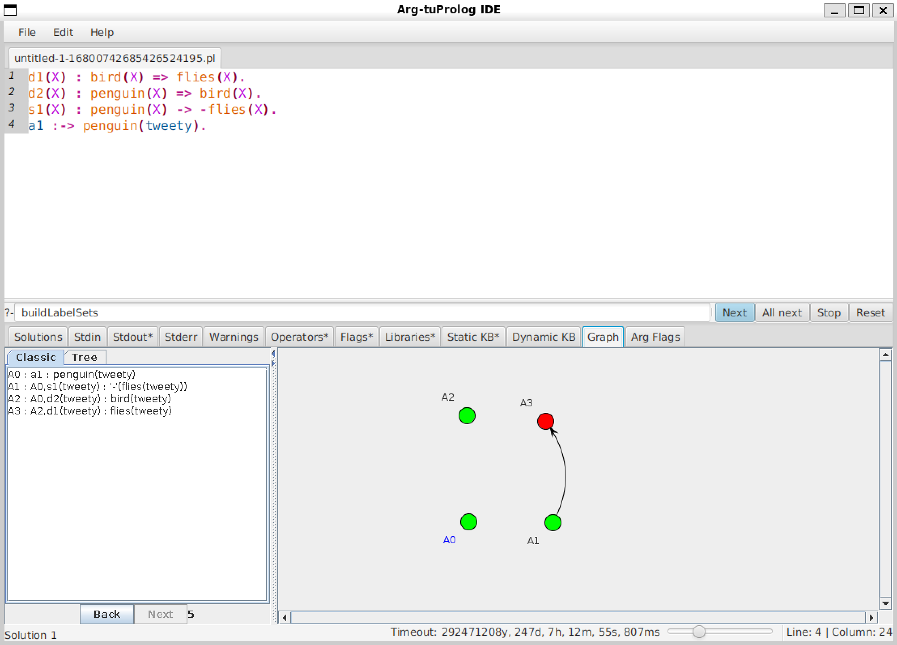
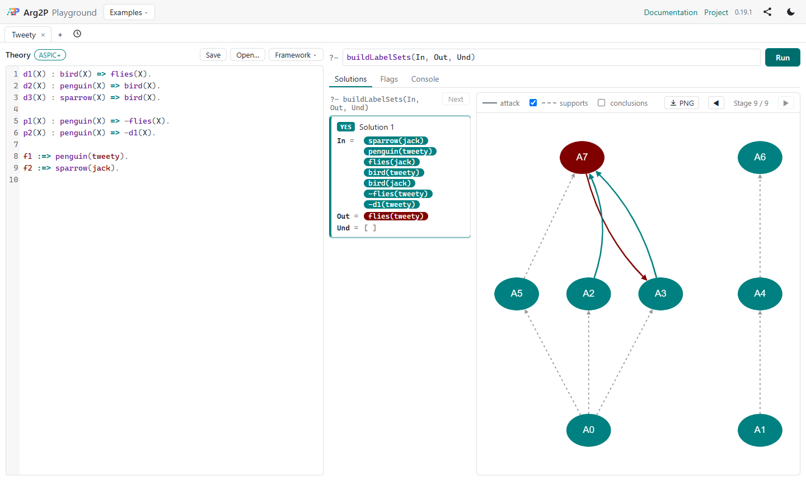
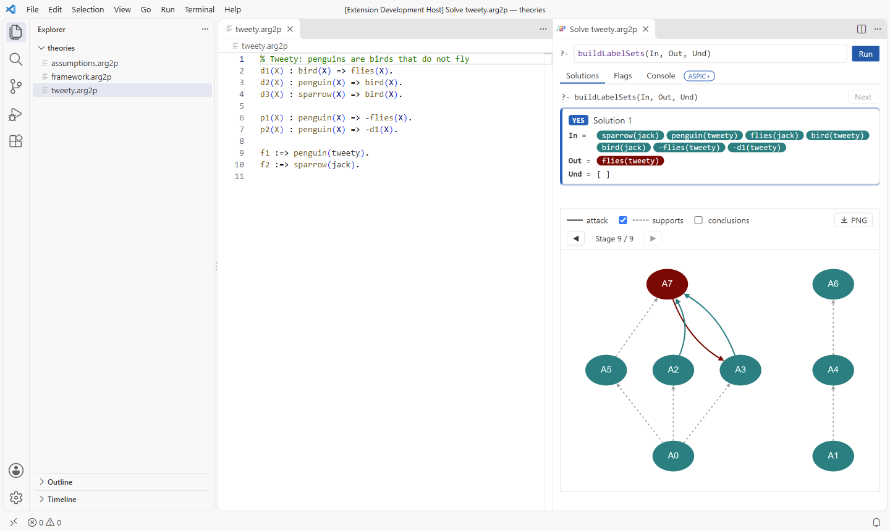

<p align="center"></p>

<h1 align="center">Arg2P</h1>

<p align="center">
  <a href="https://github.com/tuProlog/arg2p-kt/actions/workflows/push.yml"></a>
  <a href="https://central.sonatype.com/artifact/it.unibo.tuprolog.argumentation/arg2p-jvm"></a>
  <a href="https://www.npmjs.com/package/@tuprolog/arg2p"></a>
  <a href="https://pypi.org/project/arg2p/"></a>
  <a href="https://tuprolog.github.io/arg2p-kt/coverage/kotlin/index.html"></a>
  <a href="https://tuprolog.github.io/arg2p-kt/coverage/prolog.md"></a>
  <a href="https://tuprolog.github.io/arg2p-kt/"></a>
  <a href="LICENSE"></a>
</p>

Arg2P is an implementation of the ASPIC<sup>+</sup> framework for structured argumentation.
Built on top of the [tuProlog](https://apice.unibo.it/xwiki/bin/view/Tuprolog/) engine, it runs on the JVM, in JavaScript
(Node.js and browsers) and in Python, with the same API.

More details are available on the [official wiki](https://tuprolog.github.io/arg2p-kt/).

---

## Getting Started

Arg2p is available as a [2P-Kt](https://github.com/tuProlog/2p-kt/) library.

#### JVM Library - Gradle

To import the Arg2p module into your Kotlin-based Gradle project, declare the dependency in your `build.gradle(.kts)` file
(`<VERSION>` is the latest release, shown by the Maven Central badge above):
 ```kotlin
repositories {
    mavenCentral()
}

dependencies {
    implementation("it.unibo.tuprolog.argumentation:arg2p-jvm:<VERSION>")
}
 ```

#### Usage Example

```kotlin
import it.unibo.tuprolog.argumentation.Arg2p

fun main() {
    val (graph) =
        Arg2p.of(
            """
            f1 :=> d.
            f2 :=> -d.
            """.trimIndent(),
        ).graphs()

    graph.labellings.forEach {
        println("${it.label} : ${it.argument.conclusion}")
    }
}
```

For a complete example, check out the [GitHub demo](https://github.com/Gilbocc/arg2p-kt-demo).

#### NPM Library

The Arg2P software is available on NPM as a JavaScript library as well. It can be found under the [`@tuprolog` organization](https://www.npmjs.com/org/tuprolog).
To use the library, add the dependency to your `package.json` (`<VERSION>` is the latest release, shown by the npm
badge above):

```json
{
  "dependencies": {
    "@tuprolog/arg2p": "<VERSION>"
  }
}
```

#### Usage Example

```js
import { Arg2p } from '@tuprolog/arg2p'

const [graph] = Arg2p.of(`
    f1 :=> d.
    f2 :=> -d.`).graphs()

graph.labellings.forEach(it => console.log(`${it.label} : ${it.argument.descriptor}`))
```

For a complete example, see the [repository](https://github.com/tuProlog/arg2p-kt-web).


#### Python Library

The same API, in snake case, is on PyPI: `pip install arg2p` (the wheel bundles a Java runtime).

```python
from arg2p import Arg2p

(graph,) = Arg2p.of("f1 :=> d.\nf2 :=> -d.").graphs()
for labelled in graph.labellings:
    print(f"{labelled.label} : {labelled.argument.conclusion}")
```

---

## Arg2p IDE

The Arg2p IDE is available on the [Releases section of the
GitHub repository](https://github.com/tuProlog/arg2p-kt/releases/latest).



In the [latest release](https://github.com/tuProlog/arg2p-kt/releases/latest) page, download the _Asset_ named:
```
arg2p-ide-<VERSION>-redist.jar
```
a self-contained, executable Jar containing the 2P-Kt-based Prolog interpreter (`<VERSION>` is the release
version).

After you download the jar, you can simply launch it by running:
```bash
java -jar arg2p-ide-<VERSION>-redist.jar
```
If your JVM is properly configured, you can also start the IDE by double-clicking the JAR file.

### Features

- **Query Execution:** Write your query in the text field and hit <kbd>Enter</kbd> or click <kbd>&gt;</kbd>.
- **Solution Exploration:** Click <kbd>&gt;</kbd> for the next solution or <kbd>&gt;&gt;</kbd> to compute all solutions.
- **New Query:** Click <kbd>X</kbd> to stop the current query, then enter a new one.

### Additional Tabs

- **Graph Tab:** Displays a graphical representation of the abstract argumentation graph.
- **Arg Flag Tab:** Shows and allows modification of Arg2P flags. Detailed descriptions are on the [Flags](https://tuprolog.github.io/arg2p-kt/docs/api/flags/) page of the wiki.

---

## Arg2p Playground

Try Arg2P directly in your browser using the [Web Playground](https://tuprolog.github.io/arg2p-kt-web/).



No installation required: the solver runs in the browser. Write a theory, solve a query one solution at a time, and
browse the argument graph of each solution and the stages of its computation. The profile a theory states
(`graphBuildMode(aba).`, say) tells the framework it is read in, and the _Flags_ panel sets the semantics and every
other flag, with the value in effect and where it comes from.

An abstract framework is a theory too (`graphBuildMode(abstract).`, arguments `a.` and attacks `a -> b.`): it is
drawn, and the drawing edits the theory. Arguments and attacks are added, renamed and deleted by drawing, the
labelling of the solution colours them, and hovering or tapping an argument tells its label, what attacks it and what
it attacks. Frameworks are imported from APX, TGF and ICCMA'23 files, and exported to APX and TGF.


Theories are kept in tabs in the browser, shared as links, opened from and saved to files; the playground works
offline once installed as an app, on desktops, tablets and phones. Its components are on npm as
[`@tuprolog/arg2p-ui`](https://www.npmjs.com/package/@tuprolog/arg2p-ui), to embed the solver in other pages.

---

## Arg2p for VS Code

The [extension of VS Code](https://marketplace.visualstudio.com/items?itemName=tuprolog.arg2p) edits theories as
`.arg2p` files: their syntax is highlighted and their syntax errors show as they are typed. **Arg2P: Open the Solver**
opens the solver of the playground beside a theory, running on the JVM: its solutions, their graphs, the drawing of an
abstract framework and the flags.



The extension bundles the language server of Arg2P and the Java runtime it runs on; see its
[README](./vscode/README.md) for its settings.

---

## Arg2p for AI assistants (MCP)

The language server of Arg2P is also an [MCP](https://modelcontextprotocol.io/) server: AI assistants solve theories
with it (the tools `solve`, `answer`, `check`, `settings` and `explore`) rather than guessing what they conclude. The
plugin `arg2p` bundles it with the **skills** of Arg2P, to formalize problems as theories, solve them and explore their
results. In Claude Code:

```text
/plugin install arg2p --marketplace tuProlog/arg2p-kt
```

See [AI assistants](https://tuprolog.github.io/arg2p-kt/docs/run/#ai-assistants-mcp) for its tools, the other clients
and the server alone (`uvx arg2p mcp`), and the [plugin](./plugins/arg2p/README.md).

---

## Issue tracking

If you encounter any issues, please report them on the [GitHub Issues](https://github.com/tuProlog/arg2p-kt/issues) page.  
Your feedback helps improve the project!

---

## References

Arg2P is described in:

- Roberta Calegari, Andrea Omicini, Giuseppe Pisano, Giovanni Sartor.
  **Arg2P: an argumentation framework for explainable intelligent systems.**
  _Journal of Logic and Computation_, 32(2):369–401, 2022.
  [doi:10.1093/logcom/exab089](https://doi.org/10.1093/logcom/exab089)
- Giuseppe Pisano.
  **Argumentation for legal reasoning: meta-models, technology and beyond.**
  PhD thesis, Alma Mater Studiorum — Università di Bologna, 2024.
  [doi:10.48676/unibo/amsdottorato/11671](https://doi.org/10.48676/unibo/amsdottorato/11671)

Individual features — burden of persuasion, defeasible preferences, modularity, causality, distributed
reasoning — have their own papers, listed on the
[References](https://tuprolog.github.io/arg2p-kt/docs/references/) page of the wiki.

### Cite me

If you use Arg2P in academic work, please cite:

```bibtex
@article{arg2p,
  author  = {Calegari, Roberta and Omicini, Andrea and Pisano, Giuseppe and Sartor, Giovanni},
  title   = {{Arg2P}: an argumentation framework for explainable intelligent systems},
  journal = {Journal of Logic and Computation},
  volume  = {32},
  number  = {2},
  pages   = {369--401},
  year    = {2022},
  doi     = {10.1093/logcom/exab089}
}
```

```bibtex
@phdthesis{pisano2024argumentation,
  author  = {Pisano, Giuseppe},
  title   = {Argumentation for legal reasoning: meta-models, technology and beyond},
  school  = {Alma Mater Studiorum --- Universit\`a di Bologna},
  year    = {2024},
  doi     = {10.48676/unibo/amsdottorato/11671}
}
```
